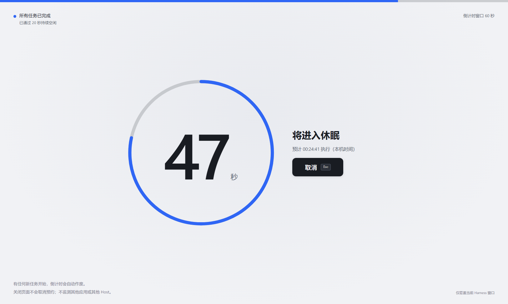
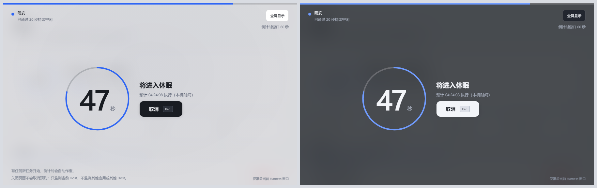
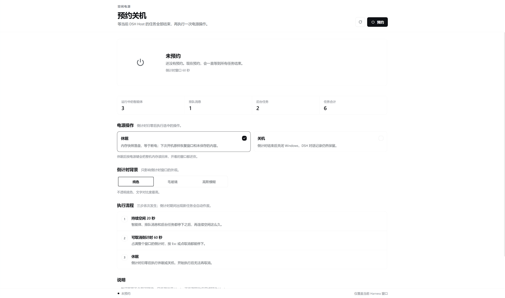

# dsh-idle-power

**English** · [简体中文](./README.zh-CN.md)

Hibernate or shut down Windows once **every** task in your DeepSeek Harness Host has finished — with a 60-second countdown that fills the whole window and can be cancelled.

Long agent runs usually end when you have walked away. This plugin lets you say *"shut the machine down when everything is actually done"*, then keeps its promise safe: it waits for all agents, subagents and background jobs in this Host, shows a full-window countdown, and **voids itself the moment new work appears**.



The background is switchable from the page: **solid** (default, above), **frosted glass**, and **gaussian blur**:



The entry sits in the left rail, right under **Plugins** and **Automation tasks**:



The page carries the power action, the countdown background, the live task counts, the flow and the notes. While a reservation is live the header button becomes **Cancel schedule** and the rail glyph grows a small dot.

---

## Why it is safe

Turning off a machine in the middle of an agent run is the interesting problem here, so the plugin is built around not doing that.

It treats the whole Harness as busy if **any** of these is true:

| Checked | Why |
|---|---|
| `agent.status === 'running'` | an agent is taking a turn |
| `agent.inbox.nextTurn` / `.nextStep` non-empty | work has been queued but not started — the hand-off gap |
| a job is `running` or `stopping` | a shell/background job is alive, including ones owned by a session |
| subagents and workflow children | they are ordinary live agents, so one status check covers them |

Then:

1. **Quiet period — 20 s.** All of the above must stay empty continuously. A single tick with work resets the clock. A missing agent registry counts as unknown activity, never as idle.
2. **Countdown — 60 s.** The whole Harness window becomes one countdown screen: a rail draining across the top edge, digits and a progress ring that scale with the display, status and warnings spread to the corners, and a high-contrast `Cancel` button (`Esc` works too).
3. **Any new task voids the countdown** and drops back to waiting. You never have to race it.
4. Only when the countdown genuinely reaches zero does it run the power command. **Once the command is committed, cancel and mode changes are refused with `409`**, so the UI can never imply a cancellation that did not happen.
5. **Waking from sleep never fires immediately.** If one tick arrives far past the deadline — the Host was frozen or the machine was suspended — the plugin re-arms and replays the whole quiet window instead of powering off the moment you sit back down.

**The countdown is the only undo you get.** `shutdown /s /t 0` runs immediately and `shutdown /h` has no `shutdown /a` counterpart, so the plugin does not rely on a Windows-provided reversal window — it provides its own.

Arming is always an explicit, human action. There is no model-facing tool, so the assistant can never decide to power off your machine.

## Modes

| Mode | Command | What you get |
|---|---|---|
| `shutdown` **(default)** | `shutdown /s /t 0 /f` | Powers off. DSH conversations are still on disk. |
| `hibernate` | `shutdown /h /f` | Writes the memory image to disk. Next boot restores every open window and unsaved edit. |

Switch modes on the page; the Host remembers the choice, so it survives a reload.

> **Fast Startup note.** If Windows Fast Startup is enabled, `shutdown /s` is a *hybrid* shutdown: the kernel state is saved and the next boot resumes it. The browser half cannot reliably detect that system setting, so the page does not claim it is on; it warns instead that apps will be forced closed and unsaved work may be lost. A true cold boot needs `powercfg /h off` (admin, permanent) — this plugin deliberately does not touch your system settings.

## The countdown screen and multiple monitors

The countdown is no longer a small centred card: the whole Harness window becomes one countdown screen, with information spread to its corners so it stays readable from across the room.

- A **rail pinned to the top edge** drains continuously and turns red for the last 10 seconds, so time is visible even in peripheral vision.
- **Giant digits** scale with `vmin` (readable on 4K, high-DPI and 200% zoom), wrapped by a ring driven by the fractional remainder so it sweeps instead of stepping once a second.
- **Information has a hierarchy**: why it started (N seconds of continuous idle) top-left, the window length top-right, the absolute "Scheduled for HH:MM:SS (local time)" and the action in the middle, and what voids the countdown / what is monitored / the unsaved-work warning along the bottom.
- **Cancel** is the highest-contrast control on screen and `Esc` works from anywhere. The tab title also carries the remaining seconds — the taskbar is often visible on every monitor, which makes this the one cross-screen cue that needs no permission.

### Multiple monitors

A web overlay can only paint inside the Harness window's own screen; it cannot draw on another display. The desktop Harness also denies every `window.open` and exposes no display-enumeration or always-on-top API to plugins, so the plugin never opens a window without an explicit click. Three layers of handling:

| Case | Behaviour |
|---|---|
| Any screen size / DPI / zoom, ultrawide, high magnification | `dvh` + `vmin` + `clamp` + wrapping flex, no fixed card width: no horizontal scroll or clipping. Short windows shrink the dial automatically and Cancel always stays above the fold. |
| Window spanning two screens (dead centre may land on the bezel) | The top rail spans the whole window; when multiple screens are detected, "Timer position" appears top-right and can pin the hero to the left or right half. |
| Multiple screens detected (`screen.isExtended`) | A "Show on other screens" button appears. Clicking it tries the Window Management API for per-screen geometry and opens one lightweight mirror window per other screen; cancelling in any window stops the power action. |

Mirrors are **best-effort**: they work in the browser-hosted Harness; the desktop build denies the pop-ups, in which case the overlay states the limitation plainly (move the Harness window to the screen you are watching, or span both screens and use "Timer position") and keeps the full-window countdown. Mirrors are driven from the main window through DOM APIs — no scripts loaded, no new Host routes, no change to the authentication boundary — and are closed when the countdown ends.

> The countdown is still owned by the Host. Closing the page or a mirror window does not cancel the reservation.

### Background styles

Three presets, switched from the page (applied immediately, remembered by the Host across reloads), with `backgroundStyle` in `cordis.patch.yml` deciding the default after a Host restart.

| Preset | Look | How contrast is kept |
|---|---|---|
| `solid` (default) | Opaque surface; the Harness window behind is fully hidden | Surface and label tokens are the host's own pair, so both themes get maximum contrast |
| `glass` | Translucent + blur + saturation; the window behind shows through faintly | A 66%-opaque surface over a dimmed, blurred layer keeps body contrast above 6:1 in both themes |
| `blur` | 34 px gaussian blur over a dark scrim with light text; an immersive dark warning | Host tokens are replaced inside this subtree with a fixed light-on-dark pair, independent of the current theme |

All three change **only the overlay itself**: the `blur` token overrides are scoped to the `.ipa-scrim` subtree and never leak into the rest of Harness. Translucency uses `color-mix()` and falls back to the opaque surface when an engine does not support it, so there is never a half-transparent unreadable state.

## Install

The plugin is a regular DSH bundle: an npm package that ships a `cordis.patch.yml` and a `dsh.client` entry.

**Option A — Plugins page (recommended).** Open the Plugins page in Harness and install the bundle `dsh-idle-power` (or the spec `github:tzzs/dsh-idle-power`). It writes the dependency and adds the bundle to your profile for you.

**Option B — edit the profile by hand.** In your profile's `package.json`, list the package and add it to the bundle list:

```jsonc
{
  "dependencies": { "dsh-idle-power": "github:tzzs/dsh-idle-power" },
  "dsh": { "profile": { "bundles": ["dsh-idle-power"] } }
}
```

Then install dependencies in the profile directory and restart Harness.

Either way, **a restart or a plugin reload is required** — the Host half registers its routes when it loads.

## Use

The entry sits in the left rail, right under **Plugins** and **Automation tasks**:


From top to bottom the page shows the current state (not scheduled / waiting · N tasks running / counting down / executing / failed), the live load, the power action, the countdown background, the flow and the notes.

- **Schedule / Cancel schedule** sits in the page header: one button that switches with the state, never both at once.
- **State on the rail** — while a reservation is live the power glyph grows a small dot; during the countdown that dot turns red and blinks. The dot survives the rail collapsing to icons.
- **Countdown background** — solid / frosted glass / gaussian blur, applied immediately and persisted on the Host.
- **How it runs** — `20 s continuously idle → 60 s cancellable countdown → run`, plus "closing this page does not cancel; only this Host is monitored".
- **What is running** — running agents, queued messages and background jobs are listed separately, with a total.
- **Connection state** — "Loading status…" before the first answer, "Cannot reach the plugin Host" with controls disabled when the connection drops, "Submitting…" while a request is in flight so a button cannot be pressed twice.
- **Failure state** — if cancelling the countdown fails, the dialog stays and says cancellation is unconfirmed instead of pretending it worked.

Keyboard: `Esc` cancels the countdown; the mode cards and the background presets move with the arrow keys / `Home` / `End`; `Tab` cycles between the cancel and multi-screen buttons inside the countdown instead of escaping the dialog.

## Configuration

Set these on the plugin row in your profile's `cordis.patch.yml`:

| Option | Default | Meaning |
|---|---|---|
| `countdownSeconds` | `60` | Countdown length, clamped to 5–3600 |
| `quietSeconds` | `20` | Required quiet period, clamped to 3–3600 |
| `defaultMode` | `'shutdown'` | `'hibernate'` or `'shutdown'` |
| `backgroundStyle` | `'solid'` | Countdown background: `'solid'` / `'glass'` / `'blur'`; an unknown value falls back to `'solid'` |
| `shutdownCommand` | `'shutdown'` | Power command; resolved via PATH when the plugin loads |

A mode or background you pick in the UI is remembered by the Host (it survives a page reload) and resets to `defaultMode` / `backgroundStyle` when the Host restarts.

## HTTP routes

The browser half talks to the Host over five authenticated routes. Every one runs a trust check first (Host/Origin, `sec-fetch-site`, then the auth cookie) and answers `403` / `401` without it.

| Method | Path | Purpose |
|---|---|---|
| `GET` | `/idle-power/state` | mode, phase, remaining seconds, background style, live task counts |
| `POST` | `/idle-power/arm` | reserve; body `{ "mode": "hibernate" \| "shutdown" }` |
| `POST` | `/idle-power/cancel` | cancel a reservation or a running countdown |
| `POST` | `/idle-power/mode` | change the mode without reserving |
| `POST` | `/idle-power/background` | change the background only; body `{ "backgroundStyle": "solid" \| "glass" \| "blur" }` |

Once the power command is committed, `/arm`, `/cancel`, `/mode` and `/background` all answer `409 execution-in-progress`. An arm whose upload was overtaken by a cancel, or whose executable check resolved out of order, answers `409 reservation-changed` instead of re-arming a reservation the user already cancelled.

`/background` is a pure appearance preference and **deliberately does not touch the reservation state machine**: it never bumps the internal revision, so changing the background can never make an in-flight arm look superseded.

Execution happens in the **Host**, not the browser. Closing the tab does not stop a countdown; that is deliberate — a browser-side timer would never fire if the browser crashed. The trade-off is that an armed reservation keeps running while Harness is open.

## Requirements

- **Windows.** `shutdown.exe` is the only backend; on other platforms the plugin reports "unsupported" instead of pretending.
- A DSH profile that mounts `agents` and `webServer`. `jobs` is optional — without it the plugin still runs, it just cannot see background jobs.

## Tests

```powershell
npm test
```

Two dependency-free harnesses drive the real code with stand-ins, so the suite can run on any machine without powering anything off:

- `test/host.test.mjs` — the state machine against fake agents, fake jobs and a subprocess that records `argv` instead of executing. Covers the busy predicate, a missing registry, quiet behaviour, countdown voiding, both command lines, cancellation, failure reporting, the mode and background routes, background config fallback for unknown values, and the races: mutations refused once execution is committed, a background change that must not disturb a pending arm, a cancel beating a slow arm upload, a stale lookup unable to overwrite a cancellation, and a suspend that overshoots the deadline re-arming instead of firing.
- `test/client.test.cjs` — renders the real `client.js` components with a minimal React stand-in and asserts on the produced tree: the rail glyph and its pending dot, every page state (loading / offline / registry unavailable / executing / failed), the live load and per-kind task breakdown, mode and background selection with their disabled states, the flow and notes, the full-screen countdown's information hierarchy and progressbar semantics, the emitted `data-background` with fallback for unknown values, the progress ring's geometry and edge cases, multi-screen detection and mirror degradation, cancel-failure feedback, and `prefers-reduced-motion` coverage.

### Cross-platform testing

The plugin **only takes effect on Windows**, but the state machine and the browser half are platform independent, so the suite runs on **Windows, Ubuntu and macOS** runners (`.github/workflows/ci.yml`, three operating systems × Node 20 and 24). To make that possible the Host half takes the platform as an injectable parameter instead of reading the global:

- `apply(ctx, config, environment)` takes a third argument used only by the tests; passing `{ platform: 'linux' }` exercises the unsupported-platform branch on any machine.
- The user-facing configuration (`cordis.patch.yml`) **cannot reach that switch**: a `platform: linux` key in the config is ignored, so a mis-copied config cannot disable the plugin on Windows. That is pinned by an assertion.

The host suite used to carry an `if (process.platform !== 'win32')` skip, which meant the whole suite **only passed on Windows**. Linux and macOS runners now execute the same assertions for real instead of skipping them.

For an interactive motion preview, open `docs/preview.html?page=1&live=1` in a browser. It uses local mock state for mode/background selection, scheduling and cancellation, and offers a simulated countdown. It sends no Host requests and never executes a power command.

The motion takes inspiration from [DesignBookmark Motion](https://designbookmark.com/motion): mode cards mark the selection with a border and a checkmark that draws in only after the Host confirms it, and the background highlight slides to the active preset. Countdown digits update in place on a fixed baseline, with no per-second displacement or flashing, and stay readable during the final red warning. The progress rail uses `transform` rather than changing layout width. All decorative motion respects `prefers-reduced-motion`, while time and cancellation keep working.

`docs/preview.html` without `live=1` is a dependency-free static preview: it renders the real `client.js` components and real stylesheet in a browser without triggering a power action. Query parameters switch states, e.g. `?s=6&mode=shutdown&multi=1` for the urgent state and the multi-screen controls, `?bg=glass` / `?bg=blur` for the backgrounds, `?page=1` for the page, `?dark=1` for the dark theme; `docs/backgrounds.html` puts frosted glass and gaussian blur side by side on one page.

Neither suite replaces looking at the page, and neither proves that `shutdown` really powers the machine off — that needs a human clicking the button.

## License

MIT
