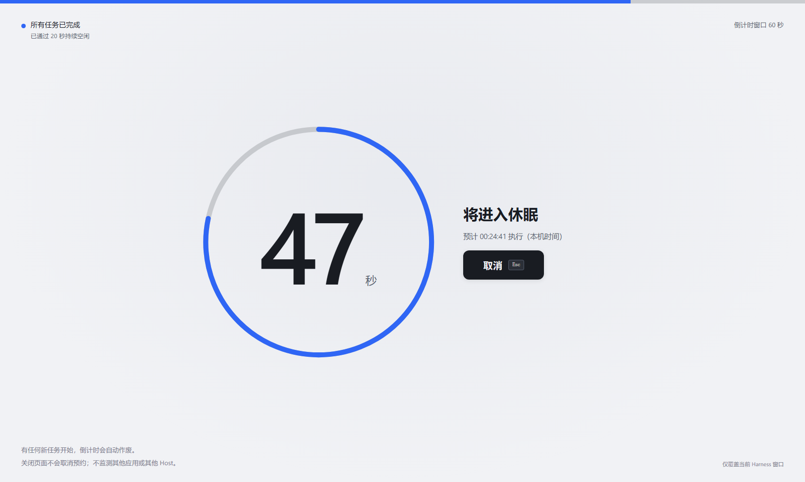
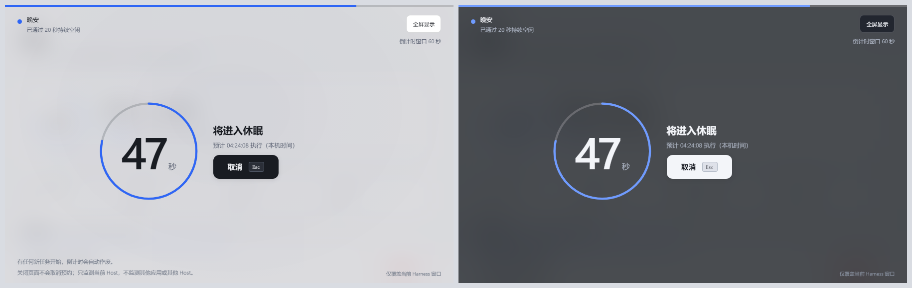
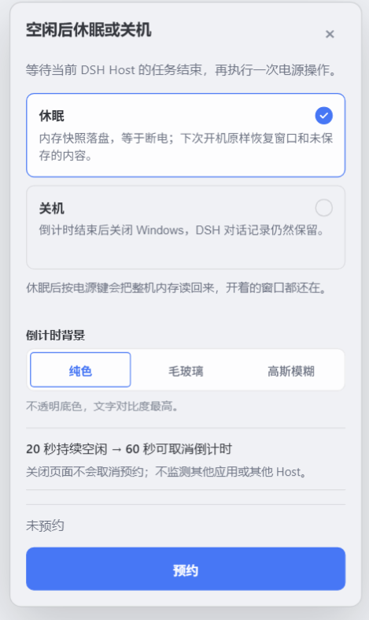

# dsh-idle-power

[English](./README.md) · **简体中文**

等 **DeepSeek Harness 当前 Host 里所有任务** 都跑完之后，自动休眠或关闭 Windows —— 先把整个 Harness 窗口变成一块 60 秒倒计时屏，随时可以取消。

长任务通常在你离开电脑之后才结束。这个插件让你提前说一句「全部跑完了就关机」，然后它用一套防误关的机制来兑现：



面板里可以切换背景：**纯色**（默认，见上图）、**毛玻璃**、**高斯模糊**：



| 选模式 | 等待中的入口 |
|---|---|
|  | 入口会写出当前真实状态：`预约关机` / `等待中 · 3 个任务在跑` / `42 秒后关机` |

---

## 为什么它不会把你正在跑的东西关掉

在 agent 任务进行中关机，是这个插件唯一重要的难题。所以它的判断覆盖整个 Harness Host：

只要满足**任意一条**，就认为还有活没干完：

| 检查项 | 原因 |
|---|---|
| `agent.status === 'running'` | 有 agent 正在执行回合 |
| `agent.inbox.nextTurn` / `.nextStep` 非空 | 已经排进队列但还没开始 —— 任务交接的空档 |
| 有 job 处于 `running` 或 `stopping` | shell / 后台任务还活着，包括挂在某个会话下面的 |

子智能体和 workflow 子节点本身就是普通 agent，所以一次状态检查就能覆盖它们。

然后：

1. **安静期 20 秒** —— 上面这些必须持续为空。任何一次检查发现活，计时归零重来；注册表不可用时按“有活”处理，不会误判空闲。
2. **倒计时 60 秒** —— 整个 Harness 窗口变成一块倒计时屏：顶部贯穿的进度条、随屏幕尺寸放大的秒数与进度环、四角铺开的状态与警告，以及对比度最高的「取消」按钮（`Esc` 也行）。
3. **一有新任务，倒计时立刻作废** —— 退回等待状态，你不需要和它抢时间。
4. 只有倒计时真正归零，才执行电源命令。**命令一旦提交执行，取消和改模式都会被拒绝（409）**，界面不会出现“取消了但其实还在关机”的错觉。
5. **睡眠/休眠后醒来不会立刻关机** —— 如果一次检查发现已经远过倒计时终点（Host 进程被挂起、机器睡过去了），插件重新回到等待，重新走完整的安静期，而不是在你刚坐回电脑前突然断电。

**倒计时是你唯一的撤销窗口。** `shutdown /s /t 0` 立即执行，`shutdown /h` 更是完全没有 `shutdown /a` 可以撤销。所以插件不依赖 Windows 提供的反悔期，而是自己提供。

预约永远是**人**的显式动作：插件不注册任何模型可见的工具，助手无法替你决定关机。

## 两种模式

| 模式 | 命令 | 结果 |
|---|---|---|
| `shutdown`（**默认**） | `shutdown /s /t 0 /f` | 断电关机。DSH 里的对话记录仍在磁盘上。 |
| `hibernate` | `shutdown /h /f` | 内存快照落盘。下次开机原样恢复所有窗口和未保存的内容。 |

在面板里切换模式，侧边栏入口的名字会跟着变（「预约关机」/「预约休眠」）。

> **快速启动说明**：如果 Windows 开着快速启动，`shutdown /s` 其实是**混合关机**——内核状态被保存、下次开机是恢复。插件在浏览器侧无法可靠检测这个系统设置，所以界面不会声称已开启，只提示「会强制关闭应用，未保存的内容可能丢失」。真要冷启动需要 `powercfg /h off`（管理员，永久生效），本插件刻意不碰你的系统设置。

## 倒计时界面与多屏幕

倒计时不再是一个居中的小卡片：整个 Harness 窗口变成一块倒计时屏，信息铺到四角，远处或余光里也能读。

- **顶部进度条**贴着窗口上沿按剩余时间连续收缩，最后 10 秒转为红色。
- **巨型秒数**按 `vmin` 缩放（4K、高 DPI、200% 缩放下仍可读），外圈进度环用未取整的剩余值平滑扫动而不是逐秒跳。
- **信息分层**：左上写「为什么开始」（已通过 N 秒持续空闲），右上写「窗口多长」，中间写「预计 HH:MM:SS 执行（本机时间）」和即将发生的操作，下方列出「什么会让它作废 / 监控范围 / 关机时未保存内容的警告」。
- **取消按钮**是全屏对比度最高的控件，任意位置按 `Esc` 都能触发。倒计时期间标签页标题也会带上剩余秒数 —— 任务栏常常在每块屏幕上都可见，这是唯一不需要额外权限的跨屏提醒。

### 多屏幕

一个 Web 覆盖层只能画在 Harness 窗口所在的那一块屏幕上，无法直接绘制到别的显示器。桌面版 Harness 还明确拒绝所有 `window.open`，也不向插件暴露显示器枚举或置顶窗口 API，所以插件**不会**在你没点过的情况下擅自弹窗。在此基础上做了三层处理：

| 情况 | 行为 |
|---|---|
| 任意屏幕尺寸 / DPI / 缩放、超宽屏、高倍率 | 布局用 `dvh`、`vmin`、`clamp` 与自动换行，没有固定卡片宽度，不会横向滚动或裁切；矮窗口自动缩小表盘，取消按钮始终在首屏。 |
| 窗口横跨两块屏幕（正中可能正好压在边框上） | 顶部进度条贯穿整个窗口；检测到多屏时右上角出现「计时器位置」，可把主体固定在左侧或右侧那半边。 |
| 检测到多块屏幕（`screen.isExtended`） | 出现「在其它屏幕也显示」按钮。点击后尝试用窗口管理 API 取各屏幕坐标，在其它屏幕各打开一个轻量镜像窗口；在任一窗口取消都会停止本次电源操作。 |

镜像窗口是**尽力而为**：浏览器版 Harness 可用；桌面版会拒绝弹窗，此时界面直接说明限制（把 Harness 窗口移到你正在看的屏幕，或跨屏后用「计时器位置」），并照常保留全窗口倒计时。镜像窗口由主窗口通过 DOM API 驱动，不加载脚本、不新增 Host 路由、不改动认证边界；倒计时结束时自动关闭。

> 倒计时仍由 Host 侧计时。关闭页面、关掉镜像窗口都不会取消预约。

### 背景样式

倒计时背景有三档预设，在面板里点一下就生效，由 Host 记住（刷新不丢），`cordis.patch.yml` 里的 `backgroundStyle` 决定 Host 重启后的默认值。

| 预设 | 观感 | 对比度怎么办 |
|---|---|---|
| `solid`（默认） | 不透明底色，背后的 Harness 完全看不到 | 表面色与文字色都取宿主 token，明暗主题下都是最高对比 |
| `glass` | 半透明 + 模糊 + 提饱和，隐约透出背后的窗口 | 表面 66% 不透明叠在压暗的模糊层上，两种主题下正文对比度仍在 6:1 以上 |
| `blur` | 34px 重度模糊 + 暗底浅字，沉浸式深色提示 | 在这个子树里把宿主 token 换成固定的浅字/暗底配对，不依赖当前主题 |

三个预设都**只改覆盖层自己**：`blur` 那套 token 覆盖作用在 `.ipa-scrim` 子树上，不会污染 Harness 其他部分。半透明用的是 `color-mix()`，引擎不支持时会自动退回不透明表面，不会出现读不清的半透明状态。

## 安装

插件就是普通的 DSH bundle：一个 npm 包，带 `cordis.patch.yml` 和 `dsh.client` 声明。

**方式 A —— 用插件页（推荐）**：在 Harness 的「插件」页安装 bundle `dsh-idle-power`（或安装串 `github:tzzs/dsh-idle-power`），它会自动写入依赖并把 bundle 加进你的 profile。

**方式 B —— 手动改 profile**：在 profile 的 `package.json` 里加上依赖和 bundle：

```jsonc
{
  "dependencies": { "dsh-idle-power": "github:tzzs/dsh-idle-power" },
  "dsh": { "profile": { "bundles": ["dsh-idle-power"] } }
}
```

然后在 profile 目录里装一次依赖，重启 Harness。

两种方式都一样：**必须重启或重载插件**——Host 半是在加载时才注册路由的。

## 使用

入口在侧边栏底部、设置旁边：

```
⏻ 预约关机            空闲
⏻ 等待中 · 3 个任务在跑   已预约，还有活在跑
⏻ 42 秒后关机          倒计时中
⏻ 正在执行电源操作       命令已提交，此时无法取消
⏻ 执行失败            命令返回非零，打开面板看原因
```

点开、选模式、按动作按钮。已预约状态下同一个按钮变成「取消预约」。

面板里还会写明：

- **倒计时背景**：纯色 / 毛玻璃 / 高斯模糊三选一，即时生效并写入 Host。
- **执行流程**：`20 秒持续空闲 → 60 秒可取消倒计时`，以及「关闭页面不会取消预约；不监测其他应用或其他 Host」。
- **在跑什么**：按「运行中的智能体 / 排队消息 / 后台任务」分项列出数量，不再只给一个总数。
- **状态反馈**：首次读取时显示「正在读取状态…」，断线显示「连不上插件 Host」并禁用操作；提交中显示「正在提交…」，按钮不会重复触发。
- **失败反馈**：倒计时里取消失败会保留弹窗并提示「取消尚未确认，请重试」，不会假装取消成功。

键盘操作：`Esc` 关闭面板或取消倒计时，`↑`/`↓`/`Home`/`End` 在模式间切换，`Tab` 在倒计时弹窗内的取消按钮与多屏按钮之间循环（不会跑出弹窗）。

折叠成 56px 轨道时入口退化为图标；Windows 下侧边栏折叠时整个底部区域被宿主隐藏，`Ctrl+B` 展开即可。

### 交互动效

参考 [DesignBookmark Motion](https://designbookmark.com/motion) 的选项切换和弹性展开思路，面板从入口轻轻展开；电源模式与背景选项用一块移动的高亮连接前后选择，勾选标记随之画入。选项在 Host 确认后才变更，提交和取消状态仍以实际请求结果为准。

倒计时表盘出现时轻微收拢，秒数在固定基线上直接更新，不做逐秒位移或闪烁；最后十秒用红色提示。进度条通过 `transform` 连续收缩，不再每帧改变布局宽度。系统开启「减少动态效果」后，展开、移动高亮与按压效果会立即切换到最终状态，时间和取消操作照常有效。

在浏览器打开 `docs/preview.html?panel=1&live=1` 可以体验模式切换、背景选择、预约和取消；也可以用预览工具栏直接播放倒计时。预览只操作本地模拟状态，不连接 Host，也不会执行电源命令。

## 配置

在 profile 的 `cordis.patch.yml` 里改插件行：

| 选项 | 默认 | 含义 |
|---|---|---|
| `countdownSeconds` | `60` | 倒计时秒数，钳制在 5–3600 |
| `quietSeconds` | `20` | 安静期秒数，钳制在 3–3600 |
| `defaultMode` | `'shutdown'` | `'hibernate'` 或 `'shutdown'` |
| `backgroundStyle` | `'solid'` | 倒计时背景：`'solid'` / `'glass'` / `'blur'`，非法值退回 `'solid'` |
| `shutdownCommand` | `'shutdown'` | 电源命令，加载时按 PATH 解析 |

你在界面上选过的模式和背景会被 Host 记住（刷新页面不丢），Host 重启后回到 `defaultMode` / `backgroundStyle`。

## 路由

浏览器半通过五条需要认证的路由和 Host 通信。每条都先检查 Host、Origin、`sec-fetch-site` 和认证 Cookie，拒绝请求时返回 `403` 或 `401`。连接服务不可用时，所有路由返回 `503`。

| 方法 | 路径 | 用途 |
|---|---|---|
| `GET` | `/idle-power/state` | 模式、阶段、剩余秒数、背景样式、在跑的任务数 |
| `POST` | `/idle-power/arm` | 预约；body `{ "mode": "hibernate" \| "shutdown" }` |
| `POST` | `/idle-power/cancel` | 取消预约或取消倒计时 |
| `POST` | `/idle-power/mode` | 没有预约时修改模式 |
| `POST` | `/idle-power/background` | 只改背景；body `{ "backgroundStyle": "solid" \| "glass" \| "blur" }` |

命令进入执行阶段后，`/arm`、`/cancel`、`/mode`、`/background` 一律返回 `409 execution-in-progress`，已经提交的电源操作不能撤。过期的预约请求，以及预约期间发往 `/mode` 的请求，会收到 `409 reservation-changed`。要修改已有预约的模式，使用 `/arm` 重新开始安静期。

`/background` 是纯外观偏好，**刻意不碰预约状态机**：它不会递增内部 revision，所以改背景永远不会让正在上传的预约被判成「已过期」。

**执行发生在 Host 侧，不在浏览器。** 关掉标签页不会中止倒计时——这是刻意的：浏览器端的定时器一旦浏览器崩溃就永远不会触发。代价是 Harness 开着的时候预约会一直有效。

## 环境要求

- **仅 Windows。** 唯一实现是 `shutdown.exe`；其他平台明确报「不支持」而不是假装能用。
- 一个挂载了 `agents` 和 `webServer` 的 DSH profile。`jobs` 可选——没有它插件照常工作，只是看不到后台任务。

## 测试

```powershell
npm test
```

两个零依赖的测试夹具用替身驱动**真实代码**，所以在任何机器上都能跑完而不会真的关机：

- `test/host.test.mjs` —— 用假 agents、假 jobs 和一个只记录 `argv` 不执行的 subprocess 驱动状态机。覆盖忙碌判定、注册表缺失、安静期行为、倒计时作废、两种命令行、取消、失败上报、模式与背景路由、背景配置的非法值回退，以及并发竞争：执行提交后的修改请求被拒绝、改背景不会让在途预约过期、取消压过正在上传的预约、过期查表结果不能覆盖取消、睡眠跨过倒计时终点后重新等待。
- `test/client.test.cjs` —— 用最小 React 替身渲染真实的 `client.js` 组件并对产出的树做断言：入口两种形态、面板各状态（读取中 / 断线 / 注册表不可用 / 执行中 / 失败）、分项任务数、三档背景的选择与禁用态、整屏倒计时的信息分层与进度条语义、`data-background` 的输出与未知值回退、进度环的几何与边界、多屏检测与镜像窗口的降级、关闭方式、倒计时取消失败反馈、`prefers-reduced-motion` 覆盖。

Host 测试还覆盖信任检查失败、连接服务不可用、过期的模式修改，以及电源命令查找期间的休眠恢复。客户端测试覆盖倒计时中所有控件的键盘访问。

### 跨平台测试

插件**只在 Windows 上真正生效**，但状态机和浏览器半与平台无关，所以测试套件在 **Windows / Ubuntu / macOS** 三种 runner 上都跑（`.github/workflows/ci.yml`，三系统 × Node 20 / 24）。为此宿主半把平台从 `process.platform` 改成了**可注入的参数**：

- `apply(ctx, config, environment)` 的第三个参数只用于测试，传 `{ platform: 'linux' }` 就能在任意机器上跑「非 Windows 拒绝预约」这条分支。
- 用户配置（`cordis.patch.yml`）**碰不到这个开关**：在配置里写 `platform: linux` 会被忽略，Windows 上的插件不会被一份误抄的配置搞坏——这条专门写了断言。

在此之前，宿主测试里有 `if (process.platform !== 'win32')` 的跳过分支，也就是说整套测试**只有 Windows 能过**；现在 Linux/macOS runner 上跑的是同一批断言的真实执行，而不是跳过。

`docs/preview.html` 是零依赖的静态预览页：用真实的 `client.js` 组件和真实样式表在浏览器里渲染倒计时与面板，不会触发电源操作。查询串可切换状态，例如 `?s=6&mode=shutdown&multi=1` 查看紧急态与多屏控件，`?bg=glass` / `?bg=blur` 对比背景，`?panel=1` 看面板，`?dark=1` 看暗色主题；`docs/backgrounds.html` 把毛玻璃与高斯模糊并排放在一页里。

两套测试都不能替代肉眼看页面，也**不能证明 `shutdown` 真的把机器关掉**——那一步需要人按一次。

## 许可

MIT
